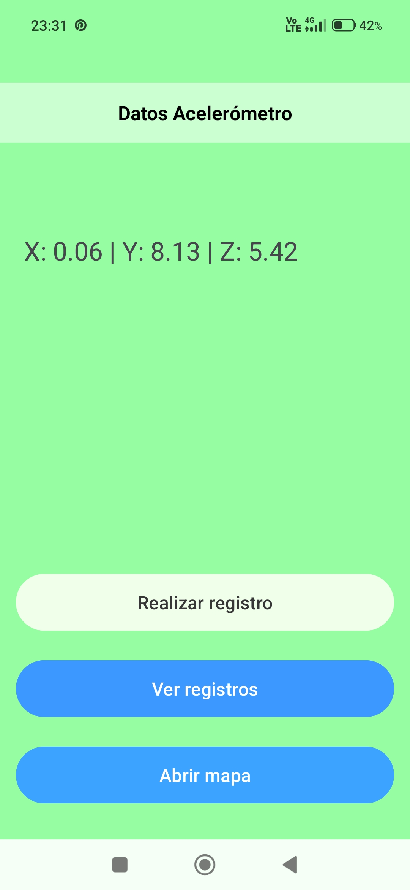
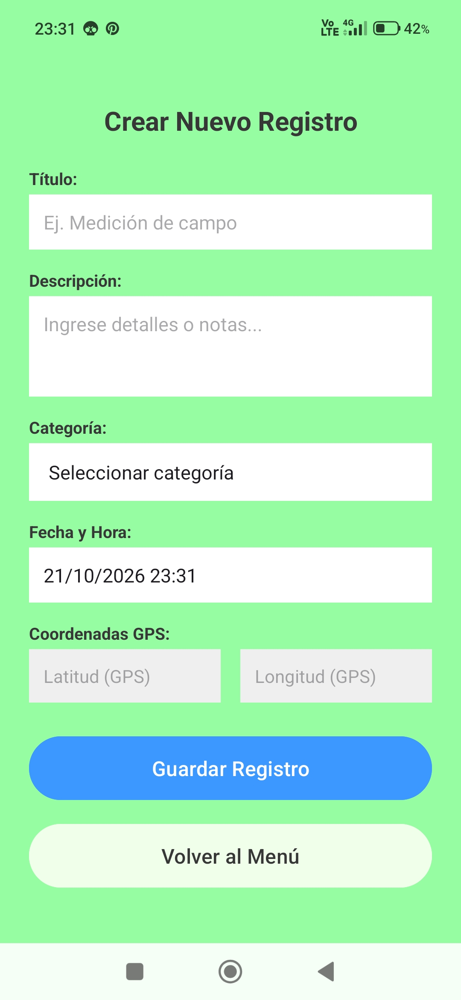
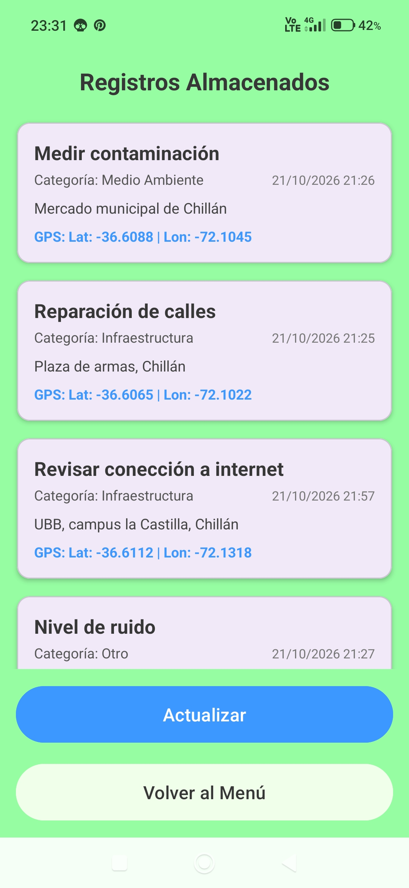
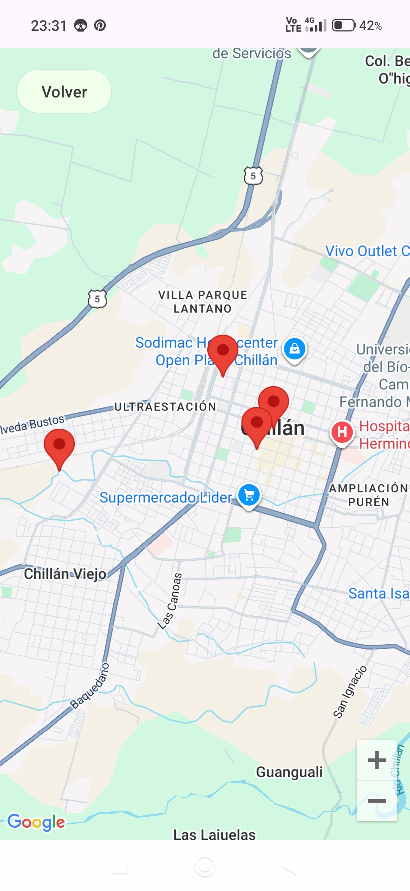

# GeoRegistro
**GeoRegistro** es una aplicación Android desarrollada en **Java** y diseñada para que personal de campo registre, consulte y visualice incidencias georreferenciadas en tiempo real y con guardado en la nube.

## Tecnologías y requerimientos:
- Lenguaje: Java.
- IDE: Android Studio Quail 3 (2026.1.3) o similar.
- SDK mínimo soportado: API nivel 27 (Android 8.1).
- SDK objetivo: API nivel 37.
- La app requiere el uso del acelerómetro y gps del dispositivo móvil o emulador.
- Servicios integrados:
  - FireBase Cloud FireStore.
  - Google Maps SDK for Android.
  - Fused Location Provider Client (GPS).
  - Hardware Sensor Manager (Acelerómetro)

## ¿Cómo usar la app?

- Clonar este repositorio en su máquina local.
- Descargar el archivo **google-service.json** desde FireBase y agregarlo dentro del directorio /app de su proyecto local.
- Abre `local.properties` en la raíz del proyecto y añade tu API Key de Google Maps: MAPS_API_KEY=tu_clave_aqui .
- Para mayor precisión en los datos necesitas otorgar permisos de ubicación a la app, de lo contrario puedes llenar los datos de longitud y latitud manualmente, aunque cuando el mapa cargue este aparecerá en una ubicación aleatoria.
- Por ultimo, sincronizar el proyecto con Gradle.

## Medidas de seguridad:
- Las credenciales privadas y claves API están excluidas del repositorio público mediante `.gitignore`.
- En FireStore se definieron reglas para permitir la lectura y creacion de los registros, no para actualizar ni borrar, esto para evitar manipulaciones no autorizadas.

## Capturas de pantalla:

